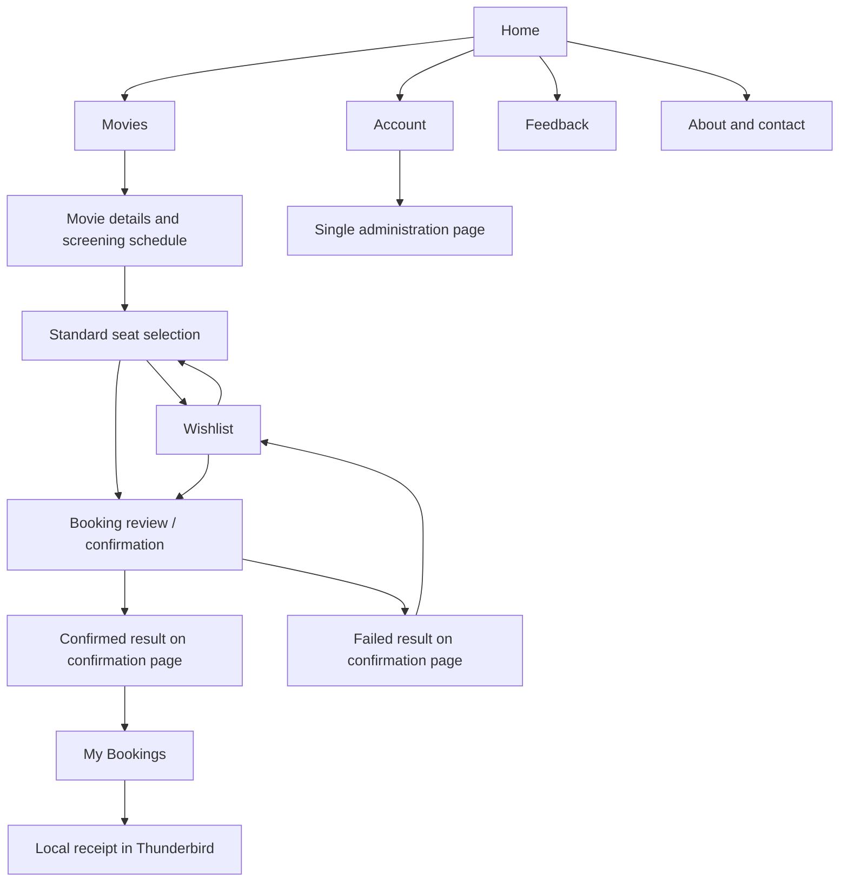

# CinéPop — implemented design and report notes

Updated 30 October 2026. This describes the corrected implementation. Review it against the students' own design work before using it in the final report.

## Application requirements

| Quality | Implemented approach and verification limits |
|---|---|
| Usability | Catalog, showtime table, seat summary, ranked shortlist, review and explicit simulated payment outcomes. Recoverable form errors and mail resend are available. |
| Responsiveness | Existing responsive grids plus account/form/navigation and small-screen corrections. Browser checks are recorded separately; this is not a claim of exhaustive device coverage. |
| Security | Password hashing; session regeneration; CSRF-protected mutations; ownership checks; prepared statements; escaped output; protected mail archives; no external email delivery. |
| Maintainability | Shared auth, booking transaction and email services; external CSS and validation JavaScript. |
| Scalability | Indexed primary/foreign keys and serialized writes per screening; suitable for the coursework demonstration. No production-scale load claim is made. |
| Accessibility | Form labels, focus outlines, status/error announcements, text alongside seat states, and reduced-motion support. Complete screen-reader conformance has not been certified. |

## Functional requirements

1. Browse/search movies and view details and future screening schedules.
2. Register/sign in and manage an authenticated customer session.
3. Select valid seats and calculate prices from hall tiers on the server.
4. Add and edit multiple wishlist choices; insert/reorder them into a contiguous preference ranking.
5. Display current availability and allow final selection of one or more choices.
6. Recheck availability in the confirmation transaction; reject duplicates, nonexistent seats and competing reservations.
7. Accept payment details through a customer checkout form; confirm approved test payments or record cancelled/failed declines without reserving seats. Outcome selection is handled internally by the local payment adapter.
8. Send successful-booking details to the user's configured local demonstration mailbox for Thunderbird retrieval.
9. Show booking history; cancel future bookings; retry email delivery.
10. Store feedback and contact enquiries.
11. Let administrators manage movies and nonoverlapping future screenings, inspect bookings/enquiries and preserve existing booking history.

## Storyboard / sitemap



Success/failure are states of confirmation.php, not additional pages. Administration sections and sign-in/registration forms are combined on their respective single pages. The complete eleven-page inventory is in README.md and includes administration.

## Wireframes

These are simplified structure diagrams, distinct from the high-fidelity reference prototypes.

```text
HOMEPAGE
[Shared logo / navigation / account actions]
[Featured movie image | title, synopsis, Book tickets]
[Now showing: poster / title / detail links]
[Coming soon]
[Cinema information and footer]

MOVIE DETAILS
[Poster | title, synopsis, rating, cast, director]
[Screening table: date / time / hall / availability / prices / seats]
[Audience reviews]

ACCOUNT
[Page title]
[Sign-in form]              [Six-field registration form]
[Inline errors and help]    [Password strength and validation]

SEAT SELECTION
[Movie / future showtime / hall]
[Screen and seat grid]      [Selected seats and total]
[Seat-state legend]         [Preference / Save wishlist / Checkout]

WISHLIST
[Ranked choices and availability] [Selected count and total]
[Checkbox / movie / seats / price] [Review selected bookings]
[Move up/down / edit / remove]

CONFIRMATION
[Review showtimes / seats / server-calculated totals]
[Cardholder / card number / expiry / security code] [Pay total]
   -> [Result, ticket details and actual mail submission status]

MY BOOKINGS
[Reference / movie / showtime / hall / seats / amount / status]
[Resend acknowledgement] [Cancel future booking]

FEEDBACK
[Movie / star rating / review form]
[Reviews from database]

ABOUT
[Cinema and hall information]
[Contact form / validation / saved-enquiry acknowledgement]

ADMINISTRATION (one page)
[Navigation anchors and revenue summary]
[Movies table and add/edit form]
[Screenings table and add form]
[Filtered booking report]
[Saved customer enquiries]
```

## Implementation details

- Traditional base: HTML, custom external CSS, vanilla JavaScript, PHP 8 and MySQL/MariaDB. Base forms submit normal HTTP POST requests to PHP. No AJAX/jQuery/JSON framework is used in the base.
- Tables: users, movies, halls, screenings, booking_wishlist, bookings, booked_seats, feedback and enquiries. Existing installations add only enquiries with the supplied upgrade SQL.
- booking_service.php centralizes seat/rank validation, pricing, ownership checks, wishlist ordering and booking transactions. Writers lock the customer row, then screening rows in ascending ID order. Availability uses current locking reads before inserting confirmed seat reservations.
- Confirmation uses session checkout tokens and POST/Redirect/GET. A completed token refers to its existing result rather than issuing another transaction on refresh/repeated submission.
- Payment failure inserts cancelled/failed booking records and no seat records. Success email is submitted only after the successful booking transaction commits.
- Local SMTP is constrained to 127.0.0.1 and an @localhost recipient. SMTP replies and timeouts are checked; failure is surfaced without undoing a saved booking. Resend is available from My Bookings.
- Administration is a single rendered page. Actions use POST with CSRF protection; deletion is refused if it would discard customer booking history or shortlist choices. Scheduling checks movie/hall validity, future dates and hall overlaps.
- Contact enquiries are validated and stored, then shown only to administrators.

## Testing

See TEST_RESULTS.md for executed checks, methods and outcomes. The repeatable test script lives in the accompanying workspace at tmp/test_fixed_website.py. It uses isolated data and a simulated SMTP server; real Thunderbird retrieval must be demonstrated separately after account setup. Add screenshots and any additional manual results to the final report instead of labelling unexecuted tests as passed.

## Features beyond the core booking requirements

- Homepage featured-film carousel and quick booking by film and date.
- My Bookings lets customers cancel eligible bookings and resend booking receipts.
- The admin dashboard manages movies and showtimes, and provides a booking report and contact enquiries.
- Successful bookings display a popcorn celebration that respects reduced-motion preferences.

